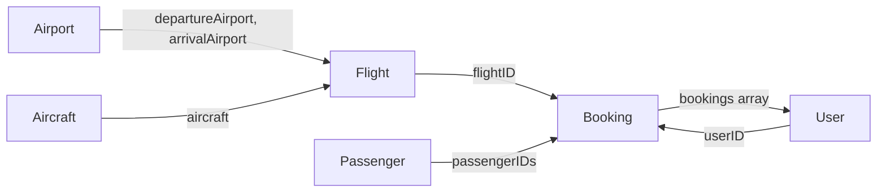

# Khảo sát QAirline cho thực nghiệm kiểm thử API

Ngày khảo sát: 2026-11-25. Nguồn: mã nguồn tại `QAirline/` trong repo này. Đây là khảo sát tĩnh; chưa khởi chạy server hoặc MongoDB. **Thao tác API** dưới đây được đếm theo cặp HTTP method + path, không phải số URL duy nhất.

## 1. Kiến trúc và cách chạy hiện tại

| Tầng | Mã nguồn và công nghệ | Vai trò |
|---|---|---|
| Giao diện | [`frontend/package.json`](../../QAirline/frontend/package.json), [`frontend/src/App.jsx`](../../QAirline/frontend/src/App.jsx) — React 18, React Router, Axios/fetch | Trang công khai và trang quản trị; lưu `userId`, `name`, `role` trong `localStorage` |
| API | [`backend/server.js`](../../QAirline/backend/server.js) — Express 4, `body-parser`, CORS | Nhận JSON, mount 10 router, phục vụ Swagger UI tại `/api-docs`; port mặc định 5000 |
| Nghiệp vụ | [`backend/controllers/`](../../QAirline/backend/controllers/) | Xử lý validation, truy vấn, cập nhật dữ liệu, tính giá vé |
| Dữ liệu | [`backend/models/`](../../QAirline/backend/models/), [`backend/config/db.js`](../../QAirline/backend/config/db.js) — Mongoose 7/MongoDB | 8 model; `MONGO_URI` từ môi trường, mặc định `mongodb://localhost:27017/qairline`; GridFS lưu file |
| Tác vụ nền | [`SchedulerController.js`](../../QAirline/backend/controllers/SchedulerController.js) | Cập nhật trạng thái flight ngay khi DB kết nối và sau đó mỗi 20 phút |

[`frontend/src/Config.js`](../../QAirline/frontend/src/Config.js) hiện trỏ đến URL Render, dù `frontend/package.json` có proxy localhost. Muốn thử nghiệm local phải cấu hình lại frontend hoặc chỉ gọi backend local trực tiếp. Tại thời điểm khảo sát chưa có `docker-compose.yml`, seed/reset DB hoặc test backend; sau khảo sát đã bổ sung [seed import](../../QAirline/README.md), còn reset DB chưa có. Chưa thấy middleware xác thực ở `server.js` hay các router; frontend tự chặn trang admin nhưng điều này không bảo vệ API.

## 2. Danh mục 48 thao tác API

Prefix lấy từ [`server.js`](../../QAirline/backend/server.js); method/path lấy từ [`backend/routes/`](../../QAirline/backend/routes/). Dấu `{id}` biểu thị path parameter. Sáu nhóm đầu là phạm vi 34 thao tác dự kiến trong [`plan.md`](../../plan.md).

| Nhóm | Method và path (sau prefix) | Số |
|---|---|---:|
| `/api/users` | `POST /login`, `POST /`, `GET /`, `GET /{id}`, `PUT /{id}`, `DELETE /{id}` | 6 |
| `/api/airports` | `POST /`, `GET /`, `GET /{id}`, `PUT /{id}`, `DELETE /{id}` | 5 |
| `/api/aircrafts` | `POST /`, `GET /`, `GET /{id}`, `GET /type/{type}`, `PUT /{id}`, `DELETE /{id}` | 6 |
| `/api/flights` | `POST /search`, `POST /`, `GET /`, `GET /{id}`, `GET /code/{code}`, `PUT /{id}`, `DELETE /{id}` | 7 |
| `/api/passengers` | `POST /`, `GET /`, `GET /{id}` | 3 |
| `/api/bookings` | `POST /`, `GET /`, `GET /{id}`, `GET /user/{userID}`, `GET /rank/popular-flights`, `PUT /{id}`, `DELETE /{id}` | 7 |
| `/api/content` | `POST /`, `GET /`, `GET /{id}`, `PUT /{id}`, `DELETE /{id}` | 5 |
| `/api/files` | `POST /upload`, `GET /`, `GET /{filename}`, `GET /image/{filename}`, `DELETE /{id}` | 5 |
| `/api/statistics` | `GET /` | 1 |
| `/scheduler` | `POST /start`, `POST /stop`, `GET /status` | 3 |

Tổng: **48**; phạm vi JSON nghiệp vụ: **34**. `POST /api/flights/search` dùng JSON body (`departureCity`, `destinationCity`, `departureDate`, `passengerCount`); `GET /api/bookings/user/{userID}` dùng query `type=Upcoming|Past`. `POST /api/files/upload` là multipart với trường `image`, nên cần executor riêng nếu đưa vào phạm vi sau.

## 3. Quan hệ dữ liệu và chuỗi gọi

Các khóa tham chiếu trong model cho thấy luồng tạo dữ liệu:

| Model | Trường có ý nghĩa cho test | Nguồn |
|---|---|---|
| Airport | `code` unique; `name`, `city` required | [`AirportModel.js`](../../QAirline/backend/models/AirportModel.js) |
| Aircraft | 11 trường required; `type` có 3 giá trị enum | [`AircraftModel.js`](../../QAirline/backend/models/AircraftModel.js) |
| Flight | tham chiếu 2 Airport + Aircraft; hai hạng ghế có `price`, `seatsAvailable`; trạng thái enum | [`FlightModel.js`](../../QAirline/backend/models/FlightModel.js) |
| User | `username`, `password`, `role`; password được bcrypt ở hook `save`; `bookings[]` | [`UserModel.js`](../../QAirline/backend/models/UserModel.js) |
| Passenger | `name`, `email`; regex email chỉ nằm trong controller tạo | [`PassengerModel.js`](../../QAirline/backend/models/PassengerModel.js), [`PassengerController.js`](../../QAirline/backend/controllers/PassengerController.js) |
| Booking | tham chiếu User, Flight, Passenger; `flightClass`, `passengerCount`, `totalPrice` | [`BookingModel.js`](../../QAirline/backend/models/BookingModel.js) |

Chuỗi tối thiểu để kiểm thử đặt vé từ DB rỗng: tạo 2 Airport → tạo 1 Aircraft → tạo 1 Flight → tạo User và Passenger → tạo Booking → đọc Booking/Flight/User → sửa hoặc xóa Booking. ID lấy từ response trước cần được đưa vào request sau. Một số response bọc object (`{airport: ...}`), một số trả document/mảng trực tiếp; bộ trích ID phải dựa trên contract từng operation.

## 4. OpenAPI hiện có

[`server.js`](../../QAirline/backend/server.js) cấu hình `swagger-jsdoc` phiên bản OpenAPI 3.0.0, quét `./routes/**/*.js` và mount UI tại `/api-docs`. Không có chú thích `@swagger`/`@openapi` trong 10 route và không có file OpenAPI độc lập trong repo. Vì vậy **chưa có mô tả `paths` hữu dụng** cho công cụ kiểm thử. Đây là kết luận từ mã nguồn, chưa xác minh bằng cách gọi `/api-docs` lúc runtime. Đường dẫn glob tương đối với working directory cũng cần kiểm tra khi chạy server từ nơi khác.

**Cập nhật sau khảo sát:** Đã thêm [`specs/qairline_openapi.json`](../../QAirline/specs/qairline_openapi.json) và cho Swagger UI dùng trực tiếp file này; backend cũng phục vụ `/api-docs.json`. File hiện mô tả 48 operation từ 10 router. Các hợp đồng response và quy tắc nghiệp vụ vẫn cần được nhóm đối chiếu thêm qua smoke test trước khi dùng làm oracle đánh giá lỗi.

OpenAPI mới phải mô tả **hành vi thực tế** và ghi riêng **hành vi mong muốn**. Ví dụ tạo username trùng hiện trả `400` trong [`UserController.js`](../../QAirline/backend/controllers/UserController.js); không được ghi `409` như một expected status nếu chưa sửa API/đặt chuẩn. Ví dụ `email`, `age` trong [`task.md`](../../task.md) chỉ minh họa, không phải schema của `POST /api/users` trong QAirline.

## 5. Khó khăn, giả thuyết lỗi và oracle cần kiểm chứng

| Mức ưu tiên | Quan sát từ code | Ca kiểm thử và giới hạn kết luận |
|---|---|---|
| Cao | `createBooking` lưu Booking rồi mới tìm User và trừ ghế, không có transaction ([`BookingController.js`](../../QAirline/backend/controllers/BookingController.js)) | User ID hợp lệ về cú pháp nhưng không tồn tại có thể gây 500 **sau khi đã ghi Booking**. Cần kiểm tra DB trước/sau để xác nhận. |
| Cao | `updateBooking` có nhánh cộng ghế chuyến cũ trước khi xác nhận ghế chuyến mới | Thử chuyển sang flight hết ghế; đối chiếu tồn kho cả hai flight trước/sau. |
| Cao | Không thấy auth/RBAC backend; tạo User nhận `role` từ request; response trả User document | Thử request không đăng nhập vào API quản trị, tự tạo `role=admin`, kiểm tra trường password hash trong response. Đây là kiểm thử bảo mật, tách khỏi tuân thủ OpenAPI. |
| Trung bình | Nhiều `findById` bắt lỗi chung và trả 500 | ID sai định dạng có thể gây Mongoose `CastError`; phân biệt với ID đúng dạng nhưng không tồn tại. Chỉ gọi là defect khi oracle mong đợi đã được nhóm chốt. |
| Trung bình | `searchFlights` tính `availableSeats` bằng `max` của hai hạng và so với `passengerCount` | Kiểm thử từng hạng ghế; khả năng trả chuyến bay dù hạng người dùng chọn không đủ chỗ. Cần xác định yêu cầu nghiệp vụ trước. |
| Trung bình | Scheduler cập nhật trạng thái theo đồng hồ thật | Test thời gian và status dễ không lặp lại; tắt scheduler hoặc dùng mốc thời gian cố định trong dataset. |
| Trung bình | `Content`, `File` dùng GridFS/multipart; response shape không thống nhất | Giữ ngoài vòng JSON chính ở V1; nếu đưa vào, bổ sung bộ xử lý multipart và binary oracle. |

## 6. Môi trường thực nghiệm đề xuất

1. Chạy backend với `MONGO_URI` trỏ đến **MongoDB cô lập**; không gửi ca ghi/xóa dữ liệu đến URL Render trong frontend.
2. Tạo seed có mã/ID ổn định hoặc lưu ID seed vào manifest; tối thiểu 2 sân bay, 1 máy bay, 1 chuyến bay có ghế, 1 user, 1 passenger. Tách dữ liệu nền khỏi dữ liệu do test tạo.
3. Reset collection trong DB thử nghiệm trước **mỗi phương pháp, mỗi lần lặp**; chụp snapshot hoặc kiểm tra DB rỗng sau reset. Dừng scheduler trong lúc đo hoặc cố định mốc giờ.
4. Giữ nguyên cùng spec, seed, ngân sách request/thời gian và danh sách operation giữa các baseline. Log request, response, thời điểm, seed, phiên bản code/spec và lỗi phát sinh.
5. Trước khi chạy tự động, đối chiếu từng operation trong OpenAPI với route, model và controller, rồi chạy smoke test local cho chuỗi tạo dữ liệu nêu trên.

## 7. Kết quả khảo sát và việc tiếp theo

Phạm vi 34 operation là khả thi cho một công cụ V1. Chướng ngại đầu tiên là **thiếu OpenAPI có nội dung**; chướng ngại thứ hai là **quản lý chuỗi phụ thuộc và reset dữ liệu**. Cần lập contract status/response và oracle nghiệp vụ có bằng chứng cho từng operation trước khi tính tỷ lệ phát hiện lỗi. Nhận định trong `plan.md` rằng URI Atlas được hardcode đã lỗi thời so với [`db.js`](../../QAirline/backend/config/db.js), vốn dùng `MONGO_URI` với mặc định localhost.
