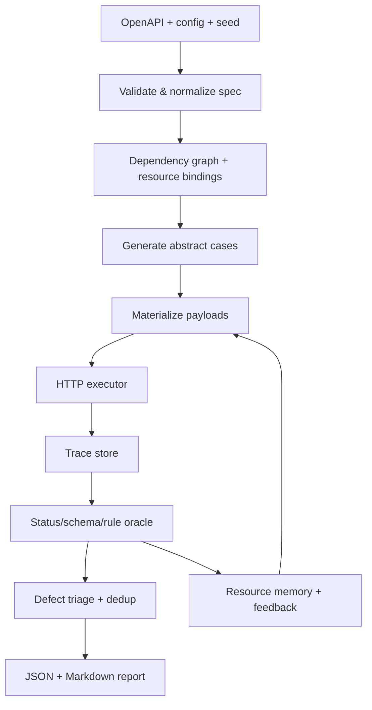

# Phương pháp nghiên cứu và thiết kế công cụ kiểm thử API V1

Ngày chốt bản thiết kế: 2026-11-25. Tài liệu này dựa trên [khảo sát QAirline](01-qairline-survey.md), [năm paper đã kiểm chứng](02-five-papers.md) và yêu cầu trong [`task.md`](../../task.md). Đây là **thiết kế cần triển khai và đánh giá**, không mô tả tính năng đã tồn tại trong repo.

## 1. Mục tiêu và ranh giới

Xây một **công cụ CLI** nhận OpenAPI + địa chỉ API thử nghiệm, tự tạo và chạy ca kiểm thử, kiểm tra response, xuất báo cáo lỗi có request tái hiện được. Công cụ cần hỗ trợ API khác nếu có OpenAPI đủ nội dung; QAirline là hệ thống đánh giá chính. V1 bao phủ JSON cho **34 operation** thuộc Users, Airports, Aircrafts, Flights, Passengers, Bookings. Multipart/GridFS, Scheduler và CMS là phần mở rộng. Executor hỗ trợ GET/POST/PUT/PATCH/DELETE dù QAirline hiện không có PATCH.

Điều kiện đầu vào: OpenAPI hợp lệ, `base_url` trỏ môi trường thử nghiệm, seed/reset đã chạy nếu test cần trạng thái, cấu hình auth nếu API cần và **rule pack tùy chọn** cho quy tắc nghiệp vụ đã duyệt. QAirline hiện có `QAirline/specs/qairline_openapi.json` (OpenAPI 3.0.0, 48 operation) được tạo từ code; nhóm cần tiếp tục đối chiếu hợp đồng response và quy tắc nghiệp vụ bằng smoke test. Thiếu rule nghiệp vụ thì validator trả `unknown` ở tầng đó, vẫn có thể kiểm tra status/schema. **Không cho Agent tự phát minh expected status hoặc business rule rồi dùng nó làm bằng chứng lỗi.** [OpenAPI 3.0 định nghĩa operation, parameter, requestBody và responses](https://spec.openapis.org/oas/v3.0.4.html); dùng validator tương ứng với phiên bản trong project.

## 2. Research questions và giả thuyết kiểm định

| RQ | Câu hỏi | So sánh/đo lường | Tiêu chí diễn giải |
|---|---|---|---|
| **RQ1 — dependency** | ODG giúp tạo chuỗi có trạng thái hợp lệ hơn sinh test độc lập không? | Full tool với/không ODG; tỷ lệ chuỗi tới bước cuối, operation coverage hợp lệ, số request cần để tạo booking | Báo chênh lệch và số lần chạy; không chỉ đếm request 2xx. |
| **RQ2 — input/feedback** | Sinh giá trị theo ngữ cảnh và sửa từ feedback tăng tỷ lệ ca hợp lệ với cùng ngân sách không? | Schema-only vs thêm value LLM vs thêm feedback; valid-input rate, request cost, thời gian và token/cost LLM | Ca invalid có chủ đích không bị tính là lỗi sinh dữ liệu. |
| **RQ3 — oracle** | Oracle status + schema + nghiệp vụ phát hiện thêm bao nhiêu lỗi đã xác nhận và báo sai bao nhiêu? | Từng tầng oracle trên cùng trace; precision/recall so với ground truth, unique confirmed defects, false positives | `unknown`/thiếu bằng chứng tách riêng; không gán tất cả 5xx là lỗi nghiệp vụ. |
| **RQ4 — tổng thể** | Công cụ V1 có hiệu quả hơn baseline trong cùng ngân sách không? | Tối thiểu Schema-only, One-shot LLM và Full tool; thêm Manual/Random nếu đủ nguồn lực; operation/sequence coverage, lỗi duy nhất xác nhận, thời gian, số request, chi phí | Chạy lặp với cùng seed, spec, phiên bản API và budget; báo cả trường hợp không cải thiện. |

RQ1–RQ3 là thí nghiệm loại bỏ thành phần (ablation), giúp giải thích **thành phần nào tạo khác biệt** thay vì chỉ có bảng so sánh tổng. 30–50 test case là mức tối thiểu trong đề; V1 đặt mục tiêu **50–100 ca** nhưng chất lượng, chuỗi hợp lệ và lỗi được xác nhận mới là thước đo chính.

## 3. Quyết định kiến trúc: một orchestrator, module tách rời

| Lựa chọn | Ưu điểm | Chi phí/rủi ro | Kết luận |
|---|---|---|---|
| Multi-Agent MARL kiểu AutoRestTest | Các agent chuyên hóa việc chọn operation/dependency/parameter/value; có bằng chứng tăng coverage trên benchmark của paper | Trạng thái và reward phức tạp, khó tái hiện đúng trong bài tập lớn; không giải quyết trực tiếp oracle nghiệp vụ | Để làm hướng nghiên cứu tiếp, không là V1 |
| Một orchestrator gọi module chuyên biệt | Một trạng thái chạy, log và ngân sách thống nhất; dễ kiểm thử từng khâu, có thể thay module/baseline | Quy tắc ưu tiên cần thiết kế rõ; có thể kém MARL trên API lớn | **Chọn cho V1** |

Một orchestrator **không đồng nghĩa với một lời gọi LLM duy nhất**: LLM chỉ dùng ở bước có lợi ích rõ (suy luận edge chưa giải được, giá trị theo ngữ nghĩa, đề xuất oracle), còn HTTP, schema validation, đối chiếu rule đã duyệt và metric phải xác định được. AutoRestTest cung cấp động lực cho điều phối thích nghi; KAT cung cấp ODG; RESTGPT cung cấp cách khai thác mô tả; LlamaRestTest cung cấp feedback; Huynh et al. cung cấp oracle response body. Chi tiết bằng chứng ở [file paper](02-five-papers.md).

**Ranh giới dùng lại:** parser OpenAPI, đồ thị phụ thuộc, bộ sinh ca, scheduler, HTTP executor, status/schema validator và reporter không chứa tên endpoint QAirline. QAirline chỉ cung cấp cấu hình fixture/seed, cách trích ID, state guard và rule pack nghiệp vụ. Truy cập DB là adapter tùy chọn để kiểm tra trạng thái sâu; API khác vẫn chạy được ở chế độ black-box bằng request/response và các API đọc trạng thái mà nó cung cấp.

### Chính sách chọn ca tiếp theo của orchestrator V1

1. Loại các ca không có setup hoặc oracle đủ tin cậy khỏi hàng đợi chấm chính; ghi lý do `blocked`/`unknown` thay vì bỏ im lặng.
2. Chạy ca valid để chứng minh có thể đạt operation/chuỗi mục tiêu và lấy resource ID. Trong số các ca có setup hợp lệ, ưu tiên operation và mục tiêu hành vi chưa được phủ.
3. Sau khi có trạng thái nền, chọn ca invalid và boundary chưa được phủ; ưu tiên chuỗi tạo được nhiều phụ thuộc hơn khi cùng ngân sách. Dùng thứ tự cố định và random seed ghi lại để kết quả tái hiện được.
4. Giảm ưu tiên ca lặp cùng lỗi hạ tầng hoặc cùng fingerprint; dừng theo giới hạn request, thời gian và token. Mọi quyết định chọn ca ghi vào trace để giải thích vì sao Agent chọn bước đó.

Đồ thị phụ thuộc gồm **cạnh dữ liệu** (`createFlight` xuất `_id` cho `createBooking.flightID`) và **điều kiện trạng thái** (`flight` tồn tại, hạng ghế hợp lệ, còn đủ ghế). Cạnh/guard do LLM đề xuất phải có bằng chứng và được kiểm chứng trước khi trở thành điều kiện bắt buộc; guard sai có thể khiến Agent bỏ qua chính ca lỗi cần phát hiện.

## 4. Luồng vận hành từ OpenAPI đến báo cáo



1. **Preflight:** kiểm tra spec có paths, operationId duy nhất, request/response schema, `base_url` thuộc allowlist local/test; xác nhận DB seed và scheduler đã được kiểm soát. Nếu thiếu schema/oracle, đánh dấu thiếu chứ không tự điền expected result.
2. **Phân tích:** chuẩn hóa operation và `$ref`; tạo cạnh phụ thuộc có `producer operation`, `response JSONPath`, `consumer field`, state guard, confidence và nguồn chứng cứ. Edge/guard có confidence thấp cần duyệt trước khi chạy.
3. **Lập kịch bản:** sinh valid, invalid, boundary và stateful sequence; orchestrator chọn theo chính sách ở trên. Invalid có chủ đích phải lưu mục đích (`missing_required`, `wrong_type`, `malformed_id`, `out_of_range`...) cùng expected behavior được duyệt.
4. **Sinh dữ liệu:** ưu tiên seed/template và constraint hình thức; gọi LLM khi cần giá trị ngữ nghĩa chưa suy được. Validate JSON do LLM tạo trước khi gửi; không để LLM chọn URL ngoài `base_url` hay tự mở rộng phạm vi.
5. **Thực thi:** ràng buộc ID từ response trước vào request sau; HTTP client có timeout, số request tối đa, concurrency thấp với luồng ghi. Lưu request/response đã che dữ liệu nhạy cảm, latency và state DB cần kiểm tra.
6. **Đánh giá:** status theo expected status đã xác nhận; schema theo đúng status/content type; rule nghiệp vụ đã duyệt; oracle bảo mật độc lập. Kết quả là `pass`, `fail`, `unknown` hoặc `infrastructure_error`.
7. **Feedback:** luôn lưu request/response và verdict của lần thử đầu dưới một trace bất biến. 4xx chỉ tạo **attempt mới có liên kết với bản gốc** khi ca định sinh hợp lệ và lỗi cung cấp gợi ý có thể hành động; retry tối đa 2 lần. 4xx của ca invalid có chủ đích là tín hiệu cần đánh giá, không phải lý do tự sửa. 5xx không tự retry vô hạn vì có thể đã thay đổi DB.
8. **Báo cáo:** gom lỗi theo operation + oracle + chữ ký response/state; giữ từng trace và một request tái hiện. Phân biệt `candidate` với `confirmed`; báo độ phủ, chi phí, trường hợp `unknown` và giới hạn đo.

## 5. Chín module và hợp đồng dữ liệu

| Module | Input → output | Cách triển khai V1 |
|---|---|---|
| 1. Spec analyzer | OpenAPI → `EndpointSpec[]` | Parser `$ref`, path/method/parameters/body/responses; metadata source. LLM chỉ thêm `proposed_rule`. |
| 2. Dependency analyzer | `EndpointSpec[]` → `DependencyEdge[]` + state guards | Heuristic tên/trường ID, OpenAPI links, `ref` Mongoose qua adapter QAirline; LLM đề xuất edge/guard còn thiếu. |
| 3. Case generator | Spec + graph → `AbstractTestCase[]` | Equivalence classes, boundary, missing/wrong-type, chuỗi create→read→update/delete. |
| 4. Data generator | Case + memory → `ConcreteRequest` | Template/seed, ràng buộc schema, optional LLM; sửa payload có log bản trước/sau. |
| 5. Executor | Request → `ExecutionTrace` | HTTP, auth/header/query/body, timeout, resource extraction; không gán expected result. |
| 6. Response validator | Trace + oracle → `ValidationResult[]` | Status, schema, rule nghiệp vụ/security có nguồn và mức tin cậy. |
| 7. Defect analyzer | Failed validations → `DefectCandidate[]` | Dedup, mức nghiêm trọng, bằng chứng, bước tái hiện; con người xác nhận ground truth. |
| 8. Memory/feedback | Trace + state → state mới | Resource pool có scope theo run/sequence, lịch sử retry, coverage, lỗi đã thấy. |
| 9. Reporter | Trace + validations + metrics → artifacts | JSON máy đọc được, Markdown tóm tắt, danh sách lỗi và request tái hiện. |

Contract chung cần chốt trước khi chia module (gợi ý đặt trong `agent/models/contracts.py`):

```text
EndpointSpec = {operation_id, method, path, parameters, request_schema,
                responses_by_status, security, source_ref}
DependencyEdge = {producer_operation, output_path, consumer_operation,
                  input_path, state_guard, evidence, confidence, reviewed}
TestCase = {id, operation_or_sequence, category, intent, expected_oracles,
            setup, cleanup, provenance}
ExecutionTrace = {case_id, attempt, request, response, elapsed_ms,
                  extracted_resources, environment_id}
ValidationResult = {case_id, oracle_id, verdict, evidence, confidence}
DefectCandidate = {fingerprint, operation, category, traces, reproduction,
                   confirmation_status}
```

`expected_oracles` không được rỗng âm thầm. Nếu chỉ biết schema mà không có quy tắc nghiệp vụ, công cụ chỉ khẳng định mức schema. `response` thiếu trường được phép có thể cho `unknown`, theo thiết kế oracle của Huynh et al. Mọi model đầu ra LLM phải qua kiểm tra schema và gắn provenance; không thực thi Python/JavaScript do LLM sinh trực tiếp.

## 6. Oracle và trường hợp QAirline đầu tiên

| Loại oracle | Ví dụ kiểm tra | Nguồn chân lý |
|---|---|---|
| Tuân thủ spec | Status/content type/schema đúng với operation và nhánh input | OpenAPI đã đối chiếu controller + quy ước được nhóm duyệt |
| Nghiệp vụ | `arrivalTime > departureTime`; `totalPrice = passengerCount × class.price`; ghế giảm khi booking và tăng khi hủy | Controller/model và quyết định nghiệp vụ được duyệt; đo trạng thái trước/sau |
| Bảo mật | Tài khoản thường/không đăng nhập không thể sửa tài nguyên admin; response User không lộ hash password | Yêu cầu bảo mật do nhóm đặt rõ; hiện code có thể không đáp ứng |
| Độ bền | ID sai dạng không gây lỗi server; thao tác thất bại không để DB dở dang | Quy tắc chất lượng do nhóm đặt rõ, không giả là đã được OAS định nghĩa |

**Ca end-to-end ưu tiên:** seed → tạo 2 Airport, Aircraft, Flight, User, Passenger → tạo Booking → GET Booking, Flight, User → kiểm `totalPrice`, ghế và liên kết → DELETE Booking → kiểm hoàn ghế và liên kết. Ca âm: thiếu trường bắt buộc, enum sai, ID sai dạng, ID đúng dạng nhưng không tồn tại, số ghế 0/quá giới hạn, chuyển booking sang flight hết ghế. Với thao tác âm, lưu DB state trước/sau để nhận diện ghi dở dang.

Benchmark QAirline có [48 dataset theo operation](../../benchmark/qairline/README.md) và các [kịch bản liên API](../../benchmark/qairline/scenarios/). Mục tiêu `coverage_target` và oracle của benchmark là dữ liệu **đánh giá giữ riêng**, không đưa cho Agent lúc sinh test. Các oracle còn `draft` chưa tính vào ground truth chính; ca cần fixture/rule review được báo riêng.

## 7. Thiết kế thực nghiệm để kết luận có giá trị

- **Ground truth:** danh sách lỗi xác nhận bằng tái hiện độc lập và kiểm tra DB, có ID, expected behavior, actual behavior, commit/spec version. Phân loại riêng lỗi spec, nghiệp vụ, bảo mật và hạ tầng. Một request 500 chỉ là **ứng viên lỗi** cho đến khi xác nhận.
- **Baseline:** Phép so sánh tối thiểu khả thi là Schema-only và One-shot LLM trên cùng OpenAPI/budget; thêm Manual hoặc Random nếu nguồn lực cho phép. Để quy kết lợi ích riêng cho ODG và feedback, cần ablation Full tool `-ODG` và `-feedback`; nếu không chạy ablation thì chỉ kết luận hiệu quả **tổng thể**, không khẳng định thành phần nào gây ra chênh lệch. Oracle nghiệp vụ có thể đo thêm bằng `-business-oracle` trên cùng trace.
- **Công bằng:** cùng `base_url` local, spec, seed, giới hạn request hoặc thời gian, số lần lặp (ít nhất 3), thứ tự chạy được ghi; reset DB trước mỗi run. Với LLM, cố định model/version/prompt/temperature và lưu token/cost. Seed ngẫu nhiên được lưu để tái hiện.
- **Năm metric yêu cầu:** (1) **API Endpoint Coverage** = số cặp method + path có ca đạt setup và thực thi / 34; báo riêng behavior/sequence coverage theo benchmark. (2) **Test Case Validity** = ca sinh đúng ý định, precondition, dữ liệu và oracle / ca được gán nhãn; không tính 4xx có chủ đích là invalidity. (3) **Response Validation Accuracy** = verdict của validator khớp nhãn chuyên gia trên các trace được gán nhãn; báo precision/recall theo lớp và `unknown` riêng. (4) **Defect Detection Rate** = lỗi đã biết hoặc mutant hợp lệ được phát hiện / tổng lỗi đã biết hoặc mutant hợp lệ trong tập đánh giá; không tuyên bố recall trên mọi lỗi chưa biết của QAirline. (5) **Testing Time** = thời gian từ bắt đầu sinh ca đến xong report, báo thêm thời gian từng pha. Metric bổ sung: unique confirmed defects, false alerts, số request, LLM tokens/cost, valid-input rate và code/branch coverage nếu có instrument backend.
- **Báo cáo thống kê:** nêu từng run và trung vị/khoảng biến thiên; không tuyên bố “vượt trội” nếu chênh lệch nhỏ hoặc ground truth chưa đầy đủ. Ghi các API/ca không kiểm tra được và nguyên nhân.

## 8. Lộ trình triển khai có thể giao việc ngay

1. **Nền tảng:** Docker MongoDB + backend local; seed/reset; tắt/kiểm soát scheduler; OpenAPI cho 34 operation; duyệt oracle benchmark và smoke test chuỗi Booking. Đây là cổng chặn trước mọi phép đo.
2. **Lõi không LLM:** chốt kiểu dữ liệu, parser/spec validator, graph dữ liệu + state guard, case generator schema, HTTP executor, status/schema oracle, report JSON. Có unit test cho parsing/binding và integration test trên DB local.
3. **Thông minh có kiểm soát:** thêm LLM rule/value/edge dưới dạng đề xuất có provenance; feedback retry có giới hạn và trace bất biến; oracle nghiệp vụ được duyệt. Đo số ca tăng nhờ từng tính năng.
4. **Thực nghiệm:** baseline tối thiểu, ablation cho thành phần muốn nhận công, ground-truth triage, 3 run/nhánh, báo cáo cùng request tái hiện; sau đó mới cân nhắc UI hoặc Multi-Agent.

**Điều kiện hoàn thành V1:** CLI chạy được từ spec đến report trên QAirline local; ít nhất 50 ca thuộc valid/invalid/boundary/stateful; 34 operation có metadata được kiểm chứng; các ca có thể tái hiện qua seed + request log; không gửi test phá hủy đến production; metric và defect có thể kiểm toán từ trace. Mục tiêu 34 operation được gọi thành công là mục tiêu thực nghiệm, **không phải điều kiện để che giấu operation thất bại**.
