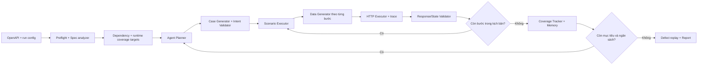

# Tổng quan phương pháp và kế hoạch xây công cụ kiểm thử API

Ngày lập: 2026-11-25. Tài liệu này tóm lược [yêu cầu đề tài](../../task.md), [khảo sát QAirline](01-qairline-survey.md), [năm paper đã kiểm chứng](02-five-papers.md), [thiết kế chi tiết](03-method-and-tool-design.md) và [benchmark QAirline](../../benchmark/qairline/README.md). [Kế hoạch code từng bước](../../tasks/plan.md) và [checklist tiến độ](../../tasks/todo.md) theo dõi phần triển khai. Đây là **phương pháp và kế hoạch triển khai**, không phải mô tả một công cụ Agent đã hoàn thành.

## 1. Bài toán, mục tiêu và phạm vi

**Bài toán:** Cho một REST API có đặc tả OpenAPI, tự động tạo các ca kiểm thử có ý nghĩa, chuẩn bị dữ liệu phụ thuộc, gửi request, đánh giá response và trạng thái liên quan, rồi báo cáo sai lệch có thể tái hiện. Chỉ kiểm tra status code hoặc sinh nhiều request ngẫu nhiên không chứng minh được API xử lý đúng nghiệp vụ. Một request `400` có thể là kết quả đúng của ca invalid; một request `201` vẫn có thể tạo giá vé hoặc số ghế sai.

**Mục tiêu sản phẩm:** Xây một **hệ thống kiểm thử API có web UI và CLI dùng chung một engine**, có thể dùng với API khác nếu có OpenAPI đủ nội dung. Người dùng cấu hình, chạy và xem kết quả trên UI; CLI phục vụ chạy tự động và thực nghiệm tái lập. QAirline là hệ thống thực nghiệm chính; phạm vi cốt lõi tập trung vào **34 operation JSON** của Users, Airports, Aircrafts, Flights, Passengers và Bookings. OpenAPI QAirline hiện mô tả **48 operation**; Content, File/GridFS, Statistics và Scheduler thuộc phạm vi mở rộng. Frontend QAirline là một phần của hệ thống bị kiểm thử, không phải UI của công cụ.

**Ranh giới kết luận:** Công cụ có thể đánh giá tuân thủ OpenAPI khi hợp đồng đủ rõ. Oracle nghiệp vụ/bảo mật chỉ được dùng để kết luận lỗi khi quy tắc đã được duyệt; nếu thiếu căn cứ thì trả `unknown`. Một HTTP 500 là ứng viên lỗi cho đến khi tái hiện, phân loại và xác nhận.

| Đầu vào khi chạy | Vai trò |
|---|---|
| OpenAPI JSON/YAML | Operation, parameter, request/response schema, security và ràng buộc hình thức. QAirline dùng [`qairline_openapi.json`](../../QAirline/specs/qairline_openapi.json). |
| `base_url` của môi trường thử nghiệm | Đích HTTP; các ca ghi dữ liệu chỉ chạy trên môi trường được phép. |
| Run config | Phạm vi operation, auth/secret, timeout, ngân sách request/thời gian/LLM, random seed và cấu hình reset. |
| Fixture/seed và rule pack tùy chọn | Tài nguyên ban đầu, cách trích ID, state guard, oracle nghiệp vụ đã duyệt. Adapter DB chỉ cần khi kiểm tra trạng thái sâu. |

**Đầu ra:** `TestCase[]`, `ExecutionPlan[]`, trace bất biến của từng attempt, assertion và verdict cho từng ca (`PASS`, `FAIL`, `UNKNOWN`, `BLOCKED`, `ERROR`, `SKIPPED`), ứng viên lỗi và kết quả tái hiện, báo cáo JSON/Markdown cùng các màn hình UI theo dõi run. Tên file và lệnh CLI chính thức sẽ được chốt ở giai đoạn hợp đồng dữ liệu; ví dụ giao diện dự kiến: `api-tester run --spec <file> --base-url <url> --config <file> --output <dir>`.

## 2. Hướng giải quyết

Chọn **một Agent Planner trong workflow LangGraph** cùng các module độc lập. Planner chọn operation/ý định tiếp theo theo khoảng trống coverage, dependency và ngân sách; Case Generator chỉ tạo ca cho mục tiêu đã chọn. Ở chế độ `schema-only`, planner dùng luật ưu tiên xác định và không gọi LLM. Ở chế độ `agent-assisted`, LLM có thể đề xuất mục tiêu, cạnh phụ thuộc hoặc giá trị có ngữ nghĩa; đề xuất phải qua schema validation, provenance và các giới hạn an toàn trước khi được dùng. HTTP, kiểm tra schema, tính metric và lưu trace vẫn là các bước xác định được. Cách kết hợp này kế thừa ý tưởng khai thác mô tả từ RESTGPT, đồ thị phụ thuộc từ KAT, điều phối thích nghi từ AutoRestTest, feedback từ LlamaRestTest và oracle response từ Huynh et al.; chi tiết và giới hạn từng paper ở [tài liệu liên quan](02-five-papers.md).



| Trách nhiệm logic | Nhiệm vụ chính | Input → output |
|---|---|---|
| Preflight | Kiểm tra spec, đích được phép, kết nối, auth probe an toàn, fixture/adapter và giới hạn run; chặn lỗi hạ tầng trước khi chạy | Spec + config → `PreflightResult` |
| Spec analyzer | Kiểm tra OAS, giải `$ref` nội bộ, chuẩn hóa operation và nguồn thông tin | OpenAPI → `EndpointSpec[]` |
| Dependency analyzer | Đề xuất producer/consumer ID từ spec, config, fixture, trace và LLM có provenance; guard có nguồn và độ tin cậy | Spec + run context → `DependencyEdge[]`, guard |
| Agent Planner | Chọn operation và ý định tiếp theo theo coverage, dependency, feedback và ngân sách | Runtime state → `TestObjective` hoặc dừng |
| Case Generator | Tạo ca valid, invalid, boundary hoặc stateful cho mục tiêu đã chọn | `TestObjective` + graph → `AbstractTestCase`, `ExecutionPlan` |
| Data Generator + Intent Validator | Tạo request ngay trước mỗi bước và xác nhận dữ liệu thật sự thỏa ý định valid/invalid/boundary | Plan step + fixture + memory → request + intent check |
| Scenario Executor | Quản lý thứ tự setup/action/observation/cleanup, binding ID, dừng và `BLOCKED` khi setup thất bại | `ExecutionPlan` → `ExecutionTrace[]` |
| HTTP Executor | Gửi **một** HTTP request, đo latency và giữ attempt/response bất biến | `ConcreteRequest` → `ExecutionTrace` |
| Response/State Validator | Kiểm tra status, content type, schema và rule đã duyệt, kèm nguồn oracle; cho phép `UNKNOWN` | Traces + oracle → `ValidationResult[]` |
| Coverage Tracker | Tính operation, parameter, boundary, intent, status và sequence coverage runtime từ trace có bằng chứng | Traces + intent → `CoverageSnapshot` |
| Memory/Feedback | Lưu resource theo run/sequence; chọn sửa dữ liệu, sửa setup, sinh ca mới hoặc dừng trong ngân sách | Trace + verdict → quyết định routing |
| Defect Analyzer + Replay | Gom lỗi trùng và tái hiện trong trạng thái phù hợp trước khi xác nhận | Failed results + traces → candidate/confirmed |
| Reporter | Tổng hợp coverage, trace, lỗi, thời gian, chi phí và giới hạn | Run state → JSON/Markdown report |

`AbstractTestCase` mô tả **ý định**; `ExecutionPlan` gồm các bước setup, action, observation/assertion và cleanup. Mỗi bước tạo request cụ thể ngay trước lúc chạy, vì ID/giá trị có thể chỉ có sau bước trước: `AbstractTestCase → ExecutionPlan → ConcreteRequest[] → ExecutionTrace[] → ValidationResult[]`. Setup lỗi làm **ca mục tiêu** thành `BLOCKED` (trừ khi chính setup là đối tượng kiểm thử của ca khác); cleanup chạy theo chính sách best effort và không ghi đè verdict đã có.

**Nguồn oracle và verdict:** Contract OpenAPI kiểm tra điều đã đặc tả; business rule chỉ quyết định `PASS/FAIL` khi đã approved; LLM inference là giả thuyết; observed behavior là bằng chứng, không mặc nhiên là chuẩn. OpenAPI [không nhất thiết liệt kê mọi status có thể xảy ra](https://spec.openapis.org/oas/v3.1#responses-object), nên status không được liệt kê chỉ là `UNKNOWN`/ứng viên lệch contract tùy độ đầy đủ của oracle, không tự động là lỗi chắc chắn. `PASS`/`FAIL` dựa vào oracle tin cậy; `UNKNOWN` thiếu căn cứ; `BLOCKED` không dựng được precondition; `ERROR` lỗi công cụ/mạng/hạ tầng; `SKIPPED` không chọn hoặc không chạy do ngân sách/chính sách. Trạng thái HTTP request **chưa rõ server đã xử lý hay chưa** là thuộc tính riêng của attempt, không đồng nhất với `UNKNOWN` của oracle.

**Lớp sản phẩm bao quanh engine:** Web UI, web API quản lý run và kho kết quả dùng chung hợp đồng dữ liệu với CLI. UI không chứa thuật toán sinh test, oracle hay logic chấm benchmark; cả UI và CLI gọi cùng engine để kết quả nhất quán.

### Giao diện và hạ tầng của hệ thống hoàn chỉnh

| Thành phần | Chức năng bắt buộc |
|---|---|
| Web UI của công cụ | Nạp/chọn OpenAPI; cấu hình base URL, phạm vi operation, auth và ngân sách; xem trước **mục tiêu và ca ban đầu**; bắt đầu/dừng run; theo dõi ca phát sinh động, tiến độ và trace; lọc operation/verdict/coverage; xem lỗi cùng bước tái hiện; tải báo cáo. |
| Web API + run manager | Xác thực cấu hình, tạo `run_id`, quản lý trạng thái queued/running/completed/failed/cancelled, phát sự kiện tiến độ, nhận lệnh dừng và cung cấp kết quả cho UI. Kiểm tra allowlist đích trước khi worker thực thi; tắt redirect tự động và chặn `$ref` ngoài spec theo mặc định. |
| Engine + worker | Phân tích spec, sinh ca, thực thi, đánh giá, lưu trace và xuất báo cáo. CLI và web API gọi cùng hợp đồng; tác vụ dài chạy ngoài tiến trình xử lý request web. |
| Kho kết quả công cụ | Lưu metadata run, test case, attempt, assertion, coverage và defect theo `run_id`; giữ trace request/response đã che secret và đường dẫn tới artifact. Benchmark được giữ riêng để không rò nhãn tham chiếu vào Agent. |

**Đề xuất lưu trữ cho bản local:** QAirline tiếp tục dùng MongoDB riêng; mỗi lượt thử nghiệm chính thức dùng DB QAirline cô lập, reset và seed lại. Công cụ dùng SQLite cho metadata và checkpoint LangGraph; trace lớn lưu JSONL, báo cáo lưu JSON/Markdown. Một worker, transaction ngắn, cơ chế đối chiếu metadata với artifact khi khởi động lại và chính sách ghi SQLite tránh lock kéo dài. Khi cần nhiều người dùng hoặc nhiều worker đồng thời mới chuyển kho công cụ/checkpoint sang PostgreSQL. Không ghi dữ liệu kết quả kiểm thử vào DB nghiệp vụ QAirline.

### Cấu trúc mã nguồn dự kiến của công cụ

`tool/` là một sản phẩm độc lập với `QAirline/`. Cây dưới đây là **thiết kế cần tạo theo các mốc F0–U3**, chưa phải khẳng định các file đã có trong repo:

```text
tool/
├── README.md                         # Cài đặt, cấu hình và lệnh chạy hệ thống
├── .gitignore                        # Bỏ qua DB, artifact, secret và môi trường local
├── compose.yaml                      # Chỉ web API + worker của công cụ
├── backend/
│   ├── .python-version               # 3.12
│   ├── requirements.txt              # Phụ thuộc runtime của API, CLI và engine
│   ├── requirements.lock             # Các phiên bản runtime đã khóa, kể cả phụ thuộc gián tiếp
│   ├── requirements-dev.txt          # Test/lint; cài kèm requirements.txt
│   ├── requirements-llm.txt          # Tích hợp LLM tùy chọn; không bắt buộc cho lõi
│   ├── .env.example                   # Mẫu cấu hình, không chứa secret thật
│   ├── app/
│   │   ├── main.py                    # Khởi tạo web API
│   │   ├── cli.py                     # Cùng service/engine như web API
│   │   ├── config.py                  # Đọc và kiểm tra cấu hình
│   │   ├── contracts/                 # Objective, Case, Plan, Step, Trace, Verdict, Run
│   │   ├── api/                       # Route: spec, run, case, trace, defect, report
│   │   ├── orchestration/
│   │   │   ├── graph.py               # LangGraph workflow
│   │   │   ├── planner.py             # Chọn mục tiêu tiếp theo
│   │   │   ├── state.py               # State của run
│   │   │   └── routing.py             # Feedback và điều kiện dừng
│   │   ├── engine/
│   │   │   ├── preflight/             # Spec/target/auth/fixture readiness
│   │   │   ├── spec/                  # Đọc/chuẩn hóa OpenAPI
│   │   │   ├── dependency/            # Đồ thị operation và state guard
│   │   │   ├── generation/
│   │   │   │   ├── case_generator.py
│   │   │   │   ├── data_generator.py
│   │   │   │   └── intent_validator.py
│   │   │   ├── execution/
│   │   │   │   ├── scenario_executor.py
│   │   │   │   ├── http_executor.py
│   │   │   │   └── resource_registry.py
│   │   │   ├── validation/            # Status, schema, rule pack, provenance
│   │   │   ├── coverage/
│   │   │   │   ├── targets.py          # Sinh runtime target từ spec/rule
│   │   │   │   ├── matcher.py          # Gắn bằng chứng vào target
│   │   │   │   └── tracker.py          # Snapshot cho planner/UI
│   │   │   ├── defects/               # Phân loại, gom trùng, replay
│   │   │   └── reporting/             # Tổng hợp và xuất JSON/Markdown
│   │   ├── runs/                      # Run manager, hàng đợi local, hủy run
│   │   ├── storage/                   # SQLite models/repositories, checkpoint, artifacts
│   │   ├── adapters/                  # Adapter tùy chọn; qairline/ chứa fixture/rules
│   │   └── benchmark/                 # Runner chấm độc lập, không import vào engine
│   └── tests/                         # Contract, unit, integration, end-to-end API
├── frontend/
│   ├── package.json                   # UI riêng của tool; lockfile đi kèm
│   └── src/
│       ├── api/                       # Client cho web API
│       ├── pages/                     # Spec/config, runs, case/trace, coverage, defects
│       └── components/                # Thành phần hiển thị dùng lại
├── scripts/                           # Reset/seed môi trường test, chạy benchmark
├── examples/qairline/                 # Compose override + cấu hình môi trường QAirline
└── data/                              # Chỉ dữ liệu runtime local; gitignore
    ├── tool.sqlite                    # Run/case/attempt/assertion/coverage/defect
    ├── checkpoints.sqlite             # Trạng thái LangGraph theo run_id
    └── artifacts/<run_id>/            # Trace JSONL và báo cáo JSON/Markdown
```

**Luồng chạy:** UI → web API → run manager → worker → LangGraph/engine → HTTP API đích. Worker ghi kết quả qua storage; UI đọc theo `run_id` qua web API. CLI gọi cùng run manager/engine để tránh hai cách sinh test khác nhau. Một worker local lấy job từ bảng `runs` trong SQLite; không cần Redis/Celery cho bản đầu. `tool/compose.yaml` chỉ chạy sản phẩm; QAirline được chạy bằng cấu hình ví dụ/override riêng để người dùng cài tool mà không cần QAirline. Cần chuyển sang hàng đợi và DB phù hợp nếu triển khai nhiều worker đồng thời. `QAirline/frontend/` chỉ là giao diện của hệ thống bị kiểm thử, không nằm trong `tool/frontend/`.

**Python và dependency:** Đề xuất **CPython 3.12.x**, ràng buộc `>=3.12,<3.13` cho backend, CLI và worker trên cả Linux/Windows; dùng môi trường conda `apitesting` theo yêu cầu triển khai, kích hoạt bằng `conda activate apitesting`. Python 3.12 vẫn được [CPython hỗ trợ bảo mật đến 10/2028](https://devguide.python.org/versions/). Tên file đúng là `requirements.txt` (số nhiều): `tool/backend/requirements.txt` dự kiến khai báo phụ thuộc trực tiếp gồm FastAPI, Uvicorn, Pydantic, HTTPX, PyYAML, thư viện kiểm tra OpenAPI/JSON Schema, LangGraph và SQLite checkpointer. `requirements.lock` khóa cả phụ thuộc gián tiếp để cài đặt tái lập; `requirements-dev.txt` chứa pytest và công cụ kiểm tra mã; `requirements-llm.txt` chứa LangChain và adapter của model được chọn. Chốt **phiên bản cụ thể có kiểm tra tương thích** ở F0, không tự giả định rằng các tên package này đã được cài hoặc mọi phiên bản mới nhất đều tương thích. [LangGraph hỗ trợ checkpoint SQLite cho local](https://docs.langchain.com/oss/python/langgraph/checkpointers).

**Ranh giới dữ liệu:** SQLite của công cụ giữ metadata và trạng thái job; checkpoint chỉ phục vụ khôi phục workflow, không thay thế trace bất biến. Benchmark tham chiếu vẫn ở `benchmark/qairline/` ngoài engine, chỉ runner chấm được đọc sau khi run kết thúc. Secret để trong biến môi trường hoặc cấu hình riêng, không lưu nguyên văn vào trace. Mỗi attempt có ID và được ghi trước/sau khi gửi HTTP; khi khôi phục không tự gửi lại request có side effect nếu chưa xác định được request trước đó đã tới server hay chưa. LangGraph [có thể chạy lại toàn bộ node sau retry hoặc resume](https://docs.langchain.com/oss/python/langgraph/fault-tolerance#retry-boundaries-and-idempotency); checkpoint không đảm bảo side effect xảy ra đúng một lần. Chỉ dùng idempotency key khi API đích thực sự hỗ trợ; nếu mất acknowledgement, đối chiếu trạng thái đích hoặc đánh dấu attempt `delivery_unknown` và dừng bước phụ thuộc.

**Giới hạn đích kiểm thử:** Web API không nhận `base_url` rồi để worker gọi tùy ý. Người quản trị cấu hình danh sách môi trường/host/port được phép; preflight và worker cùng kiểm tra URL đã chuẩn hóa, kết quả phân giải DNS và đích thực trước khi gửi. Tắt redirect tự động, chặn `file://` và `$ref` từ URL ngoài theo mặc định, giới hạn kích thước spec/response và cô lập mạng worker khi triển khai. QAirline local được cho phép tường minh. Cách này theo [khuyến nghị OWASP về SSRF](https://cheatsheetseries.owasp.org/cheatsheets/Server_Side_Request_Forgery_Prevention_Cheat_Sheet.html).

### Chính sách điều phối và feedback

1. Preflight kiểm tra spec, target được phép, kết nối và fixture. Kiểm tra auth bằng operation đọc an toàn nếu có; nếu không có probe phù hợp thì đánh dấu auth chưa xác nhận, không tự gọi API ghi dữ liệu để dò. Chỉ bắt đầu khi điều kiện bắt buộc đã sẵn sàng.
2. Planner chọn ca valid/setup hợp lệ để mở đường tới API phụ thuộc, rồi ưu tiên operation và intent valid/invalid/boundary/stateful chưa phủ. Coverage Tracker ghi riêng mục tiêu đã sinh, đã chạy và đã xác minh; một ca `BLOCKED` không tính đã phủ hành vi mục tiêu. Ghi quyết định chọn ca, random seed và ngân sách để tái hiện.
3. Scenario Executor tạo dữ liệu theo từng bước. State guard chỉ hỗ trợ dựng ca *valid*; ca negative có thể cố ý vi phạm guard, ví dụ đặt vượt số ghế. Intent Validator kiểm tra request đúng mục tiêu trước khi gửi, không sửa ca invalid thành valid.
4. Lưu **attempt đầu tiên bất biến**. Sau 4xx của ca dự định valid, feedback phân biệt `repair_data` (giá trị sai), `repair_setup` (thiếu resource), `new_case` (mục tiêu khác) và `stop`. Chỉ sửa khi có bằng chứng và còn ngân sách; tối đa hai attempt sửa cho một ca, không sửa ca invalid có chủ đích, không lặp 5xx hay lỗi hạ tầng vô hạn. Setup thất bại làm ca mục tiêu `BLOCKED`.
5. Dừng khi hết ngân sách request/thời gian/LLM, toàn bộ mục tiêu khả dụng đã phủ, người dùng hủy, hoặc không còn ca có thể chuẩn bị. Ghi rõ mục tiêu `SKIPPED`/`BLOCKED` và nguyên nhân; không biến ca chưa chạy thành `PASS`.

**Ranh giới dùng lại:** Lõi công cụ không chứa tên endpoint QAirline. Fixture, quy tắc giá vé/ghế, đường dẫn trích ID và truy cập MongoDB nằm ở adapter QAirline. API khác vẫn có thể chạy status/schema và quan hệ qua OpenAPI ở chế độ black-box; kiểm tra DB là tùy chọn. Replay chỉ chạy tự động khi môi trường có cơ chế reset/fixture phù hợp và được phép; nơi không có khả năng này giữ lỗi ở mức candidate cùng trace gốc.

## 3. Benchmark và cách đánh giá

Agent chỉ nhận OpenAPI và cấu hình chạy. [Benchmark QAirline](../../benchmark/qairline/README.md) là dữ liệu **đánh giá giữ riêng**: 48 file theo cặp method + path, 91 nghĩa vụ kiểm thử và hai [kịch bản liên API](../../benchmark/qairline/scenarios/). `coverage_target` mô tả điều kiện semantic để tính một hành vi đã được kiểm thử; `input.request` là ví dụ tái hiện, không phải chuỗi dữ liệu Agent phải sao chép. Tất cả oracle hiện còn `draft`; chỉ nghĩa vụ/scenario có expected được duyệt và fixture chuẩn bị được mới tính vào ground truth chính thức. Cần ghi riêng số mục bị loại vì thiếu fixture/rule để tránh làm đẹp metric.

**Hai loại coverage có ranh giới rõ:** Coverage Tracker lúc chạy dùng mục tiêu trích từ OpenAPI, rule pack được phép và ý định ca vừa sinh để điều phối; không đọc nhãn benchmark. Nó ghi operation/parameter/boundary/intent/status/sequence ở các mức *đã sinh*, *đã thực thi đủ setup*, *đã xác minh*. Benchmark Evaluator chỉ đọc output của run sau khi hoàn tất rồi so với `coverage_target` và oracle `approved` nằm ngoài engine. Vì vậy runtime coverage giúp Agent chọn việc tiếp theo, còn benchmark trả lời công cụ làm đúng và đủ tới đâu.

| Metric bắt buộc | Cách đo trong hệ thống |
|---|---|
| API Endpoint Coverage | Cặp method + path có ít nhất một ca đúng mục đích, đạt setup và được thực thi / 34 operation V1; báo thêm behavior/sequence coverage. |
| Test Case Validity | Ca đúng ý định, input, precondition và oracle / số ca được gán nhãn độc lập. Ca invalid có chủ đích không bị chấm sai chỉ vì nhận 4xx. |
| Response Validation Accuracy | Verdict của validator so với nhãn chuyên gia trên trace; báo precision/recall theo lớp, `unknown` và số ca chưa thể chấm. |
| Defect Detection Rate | Lỗi đã biết hoặc mutant hợp lệ được phát hiện / tổng lỗi đã biết hoặc mutant hợp lệ trong tập đánh giá; không suy rộng sang mọi lỗi QAirline chưa biết. |
| Testing Time | Thời gian từ bắt đầu sinh ca tới khi xuất xong báo cáo; báo thêm thời gian từng pha, số request và chi phí LLM. |

**So sánh tối thiểu:** Schema-only, One-shot LLM và phương pháp đầy đủ trên cùng spec, DB reset, seed, danh sách operation và ngân sách. Muốn kết luận riêng ODG hoặc feedback có tác dụng, thêm hai ablation `Full - ODG` và `Full - feedback`. Chạy lặp ít nhất ba lần mỗi nhánh, lưu seed/model/prompt/version, báo trung vị và khoảng biến thiên. So sánh với Manual/Random là phần mở rộng nếu nhóm đủ thời gian. Không tuyên bố cải thiện trước khi có dữ liệu thực nghiệm.

`schema-only` chạy không có API key với parser, generator và planner xác định; `agent-assisted` có cùng hợp đồng output nhưng cho phép LLM đề xuất có kiểm soát. Baseline One-shot LLM là nhánh thực nghiệm riêng, không phải chế độ dùng hằng ngày. Để kiểm tra ranh giới dùng lại, chạy thêm ít nhất **một OpenAPI local không thuộc QAirline** với kiểm tra status/schema và báo cáo; không yêu cầu rule pack nghiệp vụ QAirline ở thử nghiệm này.

## 4. Trạng thái repo và các phụ thuộc phải giải quyết

| Đã có | Còn thiếu trước khi đo chính thức |
|---|---|
| Backend QAirline và hướng dẫn chạy local; OpenAPI cho 48 operation | Sửa/duyệt các `contract_gap` giữa OAS và response thực tế |
| Bộ seed có importer và dữ liệu mẫu | Lệnh reset DB cô lập trước từng run; kiểm soát scheduler và ngày bay |
| Benchmark 48 dataset + hai scenario, kiểm tra cấu trúc catalog | Duyệt oracle `draft`, tạo fixture còn thiếu và runner chấm `coverage_target` |
| Tài liệu thiết kế phương pháp/paper; M0/M1 có CLI `spec/preflight/run/show`, LangGraph một ca GET, executor, contract validator, SQLite/JSONL và report | Scenario/data generation đầy đủ, coverage/planner thích nghi, web API/UI quản lý run, benchmark evaluator và baseline |
| Backend tool dùng cổng 8111; UI scaffold và proxy đã kiểm local; 31 test M0/M1 đạt | Xác minh fresh install Windows CI của T01; xem [bằng chứng M1](../../tasks/evidence/m1.md) |

Vì `import-seed.sh` chỉ thêm bản ghi thiếu, **không dùng nó như lệnh reset**. Việc duyệt oracle phải phân biệt hành vi backend hiện tại với yêu cầu mong muốn; một ca làm backend fail vẫn có thể có oracle đúng.

## 5. Kế hoạch xây dựng theo lát cắt kiểm chứng được

Thứ tự dưới đây ưu tiên một đường chạy hoàn chỉnh sớm, sau đó mới tăng độ sâu. Các mốc V1–V4 là **lát cắt kỹ thuật**, không phải bản giao nộp cuối cùng; hệ thống hoàn chỉnh phải có cả UI. Mỗi bước có thể giao cho một người trong một phiên làm việc tập trung; các bước cùng pha có thể chia nhỏ nếu phát sinh thêm ràng buộc.

| ID | Công việc và phụ thuộc | Sản phẩm | Tiêu chí hoàn thành |
|---|---|---|---|
| **F0** | Tạo khung `tool/`, Python 3.12, `requirements*.txt`/lockfile và môi trường chạy API/UI/worker cơ bản | Cây thư mục, dependency và lệnh khởi động | Cài được trên Linux/Windows với Python 3.12; web API/UI khởi động và worker kết nối kho kết quả local. |
| **F1** | Chốt hợp đồng CLI/web API, `Objective`, `TestCase`, `ExecutionPlan`, `PlanStep`, `Trace`, nguồn oracle, sáu verdict, trạng thái delivery của attempt và format report; sau F0 | Kiểu dữ liệu + ví dụ JSON | UI, CLI và engine đọc cùng contract; ca setup lỗi là `BLOCKED`; expected rỗng không báo `PASS`. |
| **F2** | Tạo môi trường Mongo thử nghiệm cô lập, reset + seed với mốc thời gian kiểm soát, kiểm soát scheduler; sau F1 | Script và run manifest | Hai lượt reset cho cùng seed/mốc thời gian tạo cùng tập ID/trạng thái; không chạm DB ngoài môi trường thử nghiệm. |
| **F3** | Duyệt OAS và một tập benchmark nhỏ cho vertical slice; sau F2 | Oracle có bằng chứng cho Airport/Flight/Booking | `contract_gap` của các response được sử dụng đã xử lý hoặc đánh dấu không chấm; có một chuỗi Booking được review. |
| **V1** | Xây đường chạy LangGraph đầu tiên: preflight → parser → ca `GET /api/airports` → HTTP executor → status/schema oracle → JSON report; sau F1 | CLI tối thiểu, chế độ `schema-only` | Một lệnh chạy được trên backend local; preflight chặn target không được phép hoặc không kết nối được; trace/verdict tái hiện được. |
| **U1** | Tạo web API, run manager, SQLite metadata và UI nhập spec/cấu hình, bắt đầu run, xem trạng thái và kết quả đầu tiên; sau V1 | Lát cắt UI → web API → engine → UI | Từ trình duyệt chạy được `GET /api/airports`, xem verdict/trace; reload trang vẫn xem được run cũ. |
| **V2** | Thêm Scenario Executor, binding theo bước và chuỗi tạo/đọc/hủy Booking; sau V1, F2 | Sequence executor | Request sau nhận ID mới; setup lỗi làm ca mục tiêu `BLOCKED`; cleanup không che verdict; crash sau POST không tự gửi lại khi outcome chưa rõ. |
| **V3** | Tách Agent Planner, Case/Data Generator, Intent Validator và Coverage Tracker; sinh invalid/boundary; sau V2 | Vòng điều phối xác định | Có ít nhất ca valid/invalid/boundary cho operation mục tiêu; intent check chứng minh ca cố ý sai đúng điều kiện; coverage có bằng chứng và điều kiện dừng. |
| **U2** | Thêm màn hình mục tiêu/ca phát sinh động, tiến độ, lọc operation/verdict và chi tiết attempt; sau U1, V3 | Giao diện vận hành run | Người dùng theo dõi chuỗi Booking, xem request/response và dừng run đang chạy; UI không hứa hiển thị trước mọi ca thích nghi. |
| **V4** | Thêm oracle provenance/rule pack, validator nghiệp vụ, defect dedup, replay có reset và report Markdown; sau V3, F3 | Báo cáo lỗi có bằng chứng | Sáu verdict tách rõ; LLM/observed không tự thành oracle; mỗi candidate có trace, trạng thái tái hiện và bước lặp lại. |
| **U3** | Thêm màn hình coverage, lỗi và bước tái hiện, tải báo cáo; sau U2, V4 | Giao diện phân tích kết quả | Từ UI truy được bằng chứng của mỗi verdict/lỗi, tải báo cáo cùng `run_id`; metric hiển thị có mẫu số. |
| **B1** | Xây runner benchmark cho `coverage_target`, scenario và nhãn lỗi; sau F3, V4 | Bộ chấm độc lập | Không đọc benchmark trong quá trình sinh test; chỉ chấm oracle approved, báo số mục bị chặn và trace của phép chấm. |
| **A1** | Thêm chế độ `agent-assisted`: LLM đề xuất mục tiêu/giá trị/edge và routing feedback có giới hạn; sau V4 | Agent có thích nghi | Output LLM qua schema validation; attempt gốc được giữ; lỗi có chủ đích không bị sửa; tắt LLM vẫn chạy được `schema-only`. |
| **G1** | Chạy một OpenAPI local khác QAirline ở chế độ black-box; sau V4 | Bằng chứng dùng lại | Chạy được từ spec tới report status/schema, không import adapter hay rule pack QAirline. |
| **E1** | Chạy baseline, ablation, 3 lần lặp và phân tích lỗi; sau B1, A1, U3, G1 | Số liệu + báo cáo nghiên cứu | Cùng ngân sách/seed/spec; năm metric có mẫu số và dữ liệu gốc; kết luận giới hạn theo bằng chứng. |

**Điểm kiểm tra tích hợp:** sau V1 phải có preflight và trace/report hoàn chỉnh từ CLI; sau U1 phải chạy được ca đầu tiên qua UI; sau V2 phải chạy và khôi phục an toàn chuỗi Booking; sau V3/U2 phải thấy ca thích nghi và coverage runtime; sau V4/U3 phải xem được lỗi và bằng chứng trên UI; sau B1 mới bắt đầu phép đo so sánh. UI là thành phần bàn giao bắt buộc nhưng làm theo lát cắt trên engine đã chạy được; không xây đủ màn hình trước khi có dữ liệu thật.

**Thứ tự ưu tiên:** P0 gồm F0–F2 và V1–V3: preflight, hợp đồng sáu verdict, Scenario Executor, Intent Validator, Planner/Coverage Tracker, an toàn side effect và giới hạn đích. P1 vẫn là **phạm vi bàn giao bắt buộc** gồm F3, V4, U1–U3, B1, A1, G1 và E1: UI, oracle nghiệp vụ, replay, hai chế độ chạy và đánh giá độc lập. P2 ngoài phạm vi hiện tại: multi-worker, PostgreSQL, multi-agent, state machine tổng quát và mutation testing quy mô lớn. P1 chỉ thể hiện thứ tự sau lõi P0, không có nghĩa là được bỏ UI hoặc benchmark.

### Tiến độ tham chiếu và vị trí mã nguồn

Nếu nhóm giữ khung **8 tuần** trong [`plan.md`](../../plan.md): tuần 1–2 làm F0–F3; tuần 3 hoàn thành V1 và U1; tuần 4–5 làm V2–V3, sau đó U2; tuần 6 làm V4, U3 và B1; tuần 7 thêm A1, G1 và kiểm thử tích hợp; tuần 8 chạy E1 và viết báo cáo. Đây là ước lượng theo phụ thuộc kỹ thuật, không phải cam kết ngày; nếu benchmark chưa có oracle approved ở tuần 6, không bắt đầu phép đo chính thức chỉ để giữ lịch.

Cây thư mục chi tiết ở mục **Cấu trúc mã nguồn dự kiến của công cụ** là cấu trúc chuẩn để triển khai. `benchmark/qairline/` tiếp tục giữ dataset, scenario và bằng chứng review **ngoài input sinh ca**. `tool/backend/requirements.txt` cùng lockfile được chốt ở F0 trên CPython 3.12; `tool/frontend/` tách khỏi frontend QAirline.

### Gợi ý phân công 5 thành viên

Theo [phân công paper hiện có](02-five-papers.md), mỗi người vừa nghiên cứu vừa làm module liên quan; hợp đồng F1 phải được cả nhóm thống nhất trước khi tách việc.

| Phụ trách theo paper | Phần triển khai chính | Bằng chứng cần bàn giao |
|---|---|---|
| RESTGPT — Nguyễn Việt Anh | Preflight, OAS/spec analyzer, rule provenance, xử lý `contract_gap`; UI cấu hình spec | Spec review, test parser/preflight, màn hình cấu hình |
| KAT — Lê Tiến Thành | Dependency graph, state guard, Case Generator, Intent Validator; UI case/coverage | Graph/sequence/intent test với Booking, coverage view |
| AutoRestTest — Vũ Đức An | Planner/orchestrator, Scenario/HTTP Executor, run manager/reset; UI run/progress | End-to-end CLI/UI và trace nhiều bước |
| Huynh et al. — Vũ Minh Thành | Oracle, defect replay, benchmark evaluator; UI lỗi/báo cáo | Assertion có bằng chứng, nhãn lỗi và báo cáo tái hiện |
| LlamaRestTest — Tô Quang Hưng | Data Generator, Coverage Tracker, memory/feedback; UI trace/attempt | Test input validity, retry trace và coverage runtime |

Việc duyệt benchmark nên có người kiểm tra chéo với người viết module tương ứng để hạn chế công cụ tự chấm theo chính giả định của mình.

## 6. Rủi ro và quyết định cần chốt

| Rủi ro | Cách xử lý |
|---|---|
| OpenAPI được viết từ code, có thể lặp lại lỗi của code | Đối chiếu yêu cầu nghiệp vụ, response thực tế và nguồn độc lập; không duyệt tự động. |
| DB/scheduler làm ca không lặp lại | Reset DB trước từng run, cố định hoặc ghi thời gian, kiểm soát scheduler. |
| LLM tạo edge/rule sai | Dùng schema đầu ra, provenance, review và trạng thái `unknown`; không chạy code do LLM sinh trực tiếp. |
| Spec không đủ hoặc auth/fixture chưa sẵn sàng | Preflight kiểm tra điều kiện bắt buộc; ca không dựng được ghi `BLOCKED`, không quy thành lỗi API. |
| Resume gửi lặp request ghi dữ liệu | Không retry node có side effect một cách mù; ghi attempt bền vững, đối chiếu trạng thái đích khi mất acknowledgement. |
| Web API bị dùng để gọi đích ngoài phạm vi | Allowlist môi trường, kiểm tra DNS/redirect và `$ref`, giới hạn mạng worker. |
| Tái hiện lỗi làm thay đổi DB hoặc không có môi trường reset | Chỉ replay trên môi trường được phép và fixture có thể reset; còn lại giữ candidate và bằng chứng gốc. |
| Benchmark chưa có oracle approved hoặc fixture | Báo mẫu số thực tế; không dùng ca draft làm ground truth chính. |
| Chỉ so sánh hai baseline rồi quy công cho từng thành phần | Thêm ablation tương ứng hoặc giới hạn kết luận ở hiệu quả tổng thể. |
| Phạm vi vượt sức nhóm | Xây UI theo lát cắt U1–U3 song song với các khả năng engine; chỉ hoãn LLM nâng cao, multipart và multi-agent. |

**Định nghĩa hoàn thành hệ thống:** Từ web UI người dùng cấu hình OpenAPI/môi trường, xem trước mục tiêu và ca ban đầu, chạy/dừng run, theo dõi ca sinh động, xem sáu verdict/trace/coverage/lỗi và tải báo cáo; CLI thực hiện cùng luồng trên QAirline local. Engine hỗ trợ ít nhất 50 ca valid/invalid/boundary/stateful trong phạm vi 34 operation; ca nhiều bước có setup/action/observation/cleanup, attempt bất biến và trạng thái delivery; báo cáo năm metric với benchmark đã duyệt, lỗi có thể tái hiện khi môi trường cho phép, và mọi operation/ca chưa chạy được được ghi nguyên nhân. Hai chế độ `schema-only`/`agent-assisted` dùng cùng contract; một OpenAPI local khác QAirline chạy được từ spec tới report. UI và CLI đọc cùng kết quả theo `run_id`; reload UI không làm mất run. Đây là tiêu chí triển khai/đánh giá, không phải tuyên bố kết quả đã đạt.
